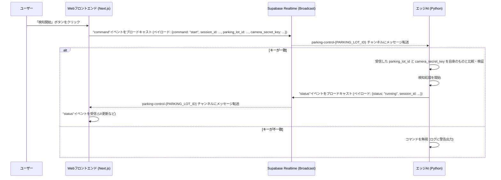
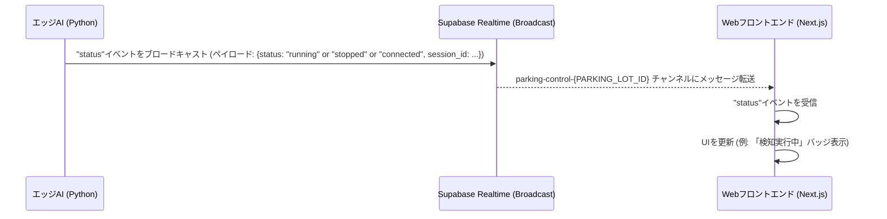

-----

# 駐車場監視システム - エッジAI連携ガイド

このドキュメントでは、駐車場監視システムのWebアプリケーションと連携するエッジAI（Pythonスクリプト `detector_realtime.py`）のセットアップ方法と、その連携の仕組みについて、わかりやすく説明します。

-----

## 目次

1.  [エッジAI (Pythonスクリプト) のセットアップ](https://www.google.com/search?q=%231-%E3%82%A8%E3%83%83%E3%82%B8ai-python%E3%82%B9%E3%82%AF%E3%83%AA%E3%83%97%E3%83%88-%E3%81%AE%E3%82%BB%E3%83%83%E3%83%88%E3%82%A2%E3%83%83%E3%83%97)
      * [1.1. 前提条件](https://www.google.com/search?q=%2311-%E5%89%8D%E6%8F%90%E6%9D%A1%E4%BB%B6)
      * [1.2. Python環境のセットアップ](https://www.google.com/search?q=%2312-python%E7%92%B0%E5%A2%83%E3%81%AE%E3%82%BB%E3%83%83%E3%83%88%E3%82%A2%E3%83%83%E3%83%97)
      * [1.3. 必要なライブラリのインストール](https://www.google.com/search?q=%2313-%E5%BF%85%E8%A6%81%E3%81%AA%E3%83%A9%E3%82%A4%E3%83%96%E3%83%A9%E3%83%AA%E3%81%AE%E3%82%A4%E3%83%B3%E3%82%B9%E3%83%88%E3%83%BC%E3%83%AB)
      * [1.4. 環境変数ファイル (.env) の設定](https://www.google.com/search?q=%2314-%E7%92%B0%E5%A2%83%E5%A4%89%E6%95%B0%E3%83%95%E3%82%A1%E3%82%A4%E3%83%AB-env-%E3%81%AE%E8%A8%AD%E5%AE%9A)
      * [1.5. Pythonスクリプトの実行](https://www.google.com/search?q=%2315-python%E3%82%B9%E3%82%AF%E3%83%AA%E3%83%97%E3%83%88%E3%81%AE%E5%AE%9F%E8%A1%8C)
2.  [フロントエンドとエッジAIの連携の仕組み (Supabase Broadcast)](https://www.google.com/search?q=%232-%E3%83%95%E3%83%AD%E3%83%B3%E3%83%88%E3%82%A8%E3%83%B3%E3%83%89%E3%81%A8%E3%82%A8%E3%83%83%E3%82%B8ai%E3%81%AE%E9%80%A3%E6%90%BA%E3%81%AE%E4%BB%95%E7%B5%84%E3%81%BF-supabase-broadcast)
      * [2.1. 概要](https://www.google.com/search?q=%2321-%E6%A6%82%E8%A6%81)
      * [2.2. チャンネル](https://www.google.com/search?q=%2322-%E3%83%81%E3%83%A3%E3%83%B3%E3%83%8D%E3%83%AB)
      * [2.3. メッセージの流れ](https://www.google.com/search?q=%2323-%E3%83%A1%E3%83%83%E3%82%BB%E3%83%BC%E3%82%B8%E3%81%AE%E6%B5%81%E3%82%8C)
          * [2.3.1. フロントエンドからエッジAIへのコマンド送信](https://www.google.com/search?q=%23231-%E3%83%95%E3%83%AD%E3%83%B3%E3%83%88%E3%82%A8%E3%83%B3%E3%83%89%E3%81%8B%E3%82%89%E3%82%A8%E3%83%83%E3%82%B8ai%E3%81%B8%E3%81%AE%E3%82%B3%E3%83%9E%E3%83%B3%E3%83%89%E9%80%81%E4%BF%A1)
          * [2.3.2. エッジAIからフロントエンドへのステータス通知](https://www.google.com/search?q=%23232-%E3%82%A8%E3%83%83%E3%82%B8ai%E3%81%8B%E3%82%89%E3%83%95%E3%83%AD%E3%83%B3%E3%83%88%E3%82%A8%E3%83%B3%E3%83%89%E3%81%B8%E3%81%AE%E3%82%B9%E3%83%86%E3%83%BC%E3%82%BF%E3%82%B9%E9%80%9A%E7%9F%A5)
      * [2.4. 認証とセキュリティ](https://www.google.com/search?q=%2324-%E8%AA%8D%E8%A8%BC%E3%81%A8%E3%82%BB%E3%82%AD%E3%83%A5%E3%83%AA%E3%83%86%E3%82%A3)
3.  [トラブルシューティング](https://www.google.com/search?q=%233-%E3%83%88%E3%83%A9%E3%83%96%E3%83%AB%E3%82%B7%E3%83%A5%E3%83%BC%E3%83%86%E3%82%A3%E3%83%B3%E3%82%B0)

-----

## 1\. エッジAI (Pythonスクリプト) のセットアップ

エッジデバイス（例: Raspberry Pi、Jetson Nanoなど、カメラが接続されたコンピュータ）でPythonスクリプトを実行するための手順を説明します。

### 1.1. 前提条件

  * **Python 3.8以上**がインストールされていること。
  * `pip` (Pythonのパッケージインストーラ) が利用可能であること。
  * 監視用**カメラ**がエッジデバイスに接続され、OpenCVなどで認識可能であること。
  * **Git**がインストールされていること（リポジトリをクローンする場合）。

### 1.2. Python環境のセットアップ

プロジェクトごとに独立したPython環境（**仮想環境**）を作成することを強く推奨します。これにより、ライブラリのバージョン競合などを防ぎ、環境をクリーンに保つことができます。

1.  **プロジェクトディレクトリの作成と移動**:

    ```bash
    mkdir parking-ai-edge
    cd parking-ai-edge
    ```

    （`detector_realtime.py` や関連ファイルをこのディレクトリに配置します。）

2.  **仮想環境の作成**:

    ```shellscript
    python -m venv .venv
    ```

    （`.venv` という名前の仮想環境が作成されます。）

3.  **仮想環境のアクティベート**:
    以下のコマンドで仮想環境を有効にします。アクティベートされると、コマンドプロンプトの先頭に `(.venv)` のような表示が追加されます。今後、このプロジェクトで作業する際は、常にこの仮想環境をアクティベートしてください。

      * **Windows**:
        ```shellscript
        .venv\Scripts\activate
        ```
      * **macOS / Linux**:
        ```shellscript
        source .venv/bin/activate
        ```

### 1.3. 必要なライブラリのインストール

`detector_realtime.py` を実行するために必要なPythonライブラリをインストールします。仮想環境がアクティベートされた状態で、以下のコマンドを実行してください。

```shellscript
pip install -r requirements.txt
```

  * `ultralytics`: YOLOv8などの物体検知モデルを使用するためのライブラリ。
  * `opencv-python`: 画像処理、カメラアクセスに使用。
  * `python-dotenv`: `.env` ファイルから環境変数を読み込むために使用。
  * `supabase`: Supabase Pythonクライアント（主にデータベース操作やストレージ操作に使用しますが、本スクリプトでは直接的なDB操作は限定的）。
  * `websockets`: Supabase Realtime (WebSocket) との通信に使用。
  * `httpx`: Supabaseクライアント内部で使用されるHTTPクライアント。
  * `asyncio`: 非同期処理に使用。
  * `uuid`: 一意なID生成に使用。

### 1.4. 環境変数ファイル (.env) の設定

Pythonスクリプトは、Supabaseへの接続情報や駐車場固有の情報を**環境変数ファイル** (`.env`) から読み込みます。
`detector_realtime.py` と同じディレクトリに `.env` という名前のファイルを作成し、以下の内容を記述・編集してください。

```plaintext
# SupabaseプロジェクトのURL (例: https://xxxxxxxxxxxx.supabase.co)
SUPABASE_URL="YOUR_SUPABASE_URL"

# SupabaseプロジェクトのAnon Key (公開キー)
SUPABASE_ANON_KEY="YOUR_SUPABASE_ANON_KEY"

# このエッジAIが監視する駐車場のID
# アプリケーションにオーナーとしてログインし、駐車場を選択すると表示される「駐車場ID」をここに設定します。
PARKING_LOT_ID="YOUR_PARKING_LOT_ID"

# このエッジAIが使用するカメラ認証キー
# アプリケーションにオーナーとしてログインし、駐車場を選択すると表示される「カメラ認証キー」をここに設定します。
CAMERA_SECRET_KEY="YOUR_CAMERA_SECRET_KEY"

VIDEO_SOURCE="0" # または "your_video_file.mp4"
REGIONS_FILE_PATH="path/to/your/regions.json"
MODEL_PATH="path/to/your/yolov8n.pt" # または yolov8s.pt, yolov8m.pt など
```

**各設定値の取得方法:**

  * **`SUPABASE_URL` および `SUPABASE_ANON_KEY`**:

    1.  [Supabaseのプロジェクトダッシュボード](https://supabase.com/dashboard)にアクセスします。
    2.  該当するプロジェクトを選択します。
    3.  左側のメニューから「Project Settings」(歯車アイコン) \> 「API」を選択します。
    4.  「Configuration」セクションにある「Project URL」と、「Project API keys」セクションにある `anon` `public` キーをコピーして、それぞれ `.env` ファイルに設定します。

  * **`PARKING_LOT_ID` および `CAMERA_SECRET_KEY`**:

    1.  本駐車場管理Webアプリケーションに**オーナーアカウント**でログインします。
    2.  左パネルの「駐車場を選択」ドロップダウンから、このPythonスクリプトで監視したい駐車場を選択します。
    3.  選択後、その下に「駐車場認証情報」というカードが表示されます。そこに記載されている「駐車場ID」と「カメラ認証キー」をコピーし、それぞれ `.env` ファイルに設定します。

**重要**: `.env` ファイルは機密情報を含むため、Gitリポジトリにコミットしないでください。`.gitignore` ファイルに `.env` を追加することを強く推奨します。

### 1.5. Pythonスクリプトの実行

すべての設定が完了したら、ターミナルまたはコマンドプロンプトで、**仮想環境がアクティベートされた状態**で、Pythonスクリプトを実行します。

```shellscript
python detector.py
```

スクリプトが正常に起動すると、以下のようなログが表示されます（一部抜粋）。

```plaintext
INFO:__main__:Supabase Realtime (parking-control-YOUR_PARKING_LOT_ID) に接続しました
INFO:__main__:チャンネル parking-control-YOUR_PARKING_LOT_ID に参加しました
INFO:__main__:ステータス送信成功: connected
```

これで、エッジAIはWebアプリケーションからのコマンドを待機している状態になります。Webアプリケーション側で「検知開始」ボタンを押すと、カメラ映像の処理が開始されます。

-----

## 2\. フロントエンドとエッジAIの連携の仕組み (Supabase Broadcast)

このシステムでは、Webフロントエンド（Next.jsアプリケーション）とエッジAI（Pythonスクリプト）間のリアルタイム通信に、Supabaseの**Realtime Broadcast**機能を利用しています。

### 2.1. 概要

Supabase Realtimeは、WebSocketプロトコルを使用して、クライアント間で低遅延な双方向通信を実現するサービスです。**Broadcast機能**は、特定の「チャンネル」に参加している全クライアントに対してメッセージを一斉送信（ブロードキャスト）することを可能にします。

### 2.2. チャンネル

通信は「**チャンネル**」という単位で行われます。このシステムでは、各駐車場ごとにユニークなチャンネル名が使用されます。チャンネル名は `parking-control-{PARKING_LOT_ID}` という形式です。

  * **フロントエンド**: ユーザーがWebアプリケーションで特定の駐車場を選択すると、その駐車場のIDに対応するチャンネルに接続します。
  * **エッジAI**: Pythonスクリプト起動時に、`.env` ファイルで指定された `PARKING_LOT_ID` に基づくチャンネルに接続します。

これにより、特定の駐車場に関するコマンドやステータスは、その駐車場専用のチャンネルを通じて、関連するフロントエンドとエッジAI間でのみ共有されます。

### 2.3. メッセージの流れ

#### 2.3.1. フロントエンドからエッジAIへのコマンド送信 (例: 検知開始/停止)

ユーザーがWebフロントエンドで「検知開始」や「検知停止」の操作を行うと、そのコマンドはSupabase Broadcastを通じてエッジAIに送られます。



1.  **ユーザー操作**: ユーザーがWebフロントエンドで「検知開始」または「検知停止」ボタンをクリックします。
2.  **コマンド送信**: フロントエンドは、選択されている駐車場のチャンネルに対して、`command` というイベント名でメッセージをブロードキャストします。ペイロードには、実行すべきコマンド (`start` または `stop`)、セッションID、駐車場ID、そして**カメラ認証キー**が含まれます。
3.  **コマンド受信**: 同じチャンネルに参加しているエッジAI（Pythonスクリプト）がこのメッセージを受信します。
4.  **認証と処理**: エッジAIは、受信したメッセージ内の `parking_lot_id` と `camera_secret_key` が、自身の `.env` ファイルに設定された値と一致するか検証します。
      * 一致する場合: コマンド（検知開始または停止）を実行します。
      * 一致しない場合: コマンドを無視し、不正な試みとしてログに記録することがあります。
5.  **ステータス応答**: コマンド実行後、エッジAIは現在の動作ステータス（例: `running`, `stopped`）を、同じチャンネルを通じてフロントエンドに通知します（後述）。

#### 2.3.2. エッジAIからフロントエンドへのステータス通知

エッジAIの状態が変化した際（起動、検知開始、停止など）には、そのステータスがフロントエンドに通知され、Webアプリケーションの表示がリアルタイムに更新されます。



1.  **ステータス変更時**: エッジAIが起動してSupabase Realtimeに接続したとき、または検知処理を開始/停止したときなど、自身の状態が変化した際にステータスを通知します。
2.  **ステータス送信**: エッジAIは、自身のチャンネルに対して `status` というイベント名でメッセージをブロードキャストします。ペイロードには、現在のステータス（例: `connected`, `running`, `stopped`）やセッションIDが含まれます。
3.  **ステータス受信**: 同じチャンネルに参加しているフロントエンドがこのメッセージを受信します。
4.  **UI更新**: フロントエンドは、受信したステータス情報に基づいて、ユーザーインターフェースをリアルタイムに更新します（例: 「検知実行中」バッジの表示、ボタンの有効/無効状態の切り替えなど）。

### 2.4. 認証とセキュリティ

  * **チャンネル分離**: 駐車場IDごとにチャンネルが分離されているため、ある駐車場のコマンドが別の駐車場のエッジAIに影響を与えることはありません。
  * **カメラ認証キー**: フロントエンドから送信されるコマンドには `camera_secret_key` が含まれます。エッジAI側でこのキーを検証することで、意図しない第三者からの不正なコマンド実行を防ぎます。このキーは `.env` ファイルに設定され、外部に漏れないように管理する必要があります。
  * **Supabase Anon Key**: WebSocket接続にはSupabaseの `anon` (公開) キーが使用されます。このキー自体はクライアントサイドで公開されても問題ないように設計されていますが、データベースの**行レベルセキュリティ (RLS) ポリシー**を適切に設定し、不正なデータアクセスを防ぐことが非常に重要です。Broadcast自体はRLSの影響を受けませんが、Broadcastをトリガーとするデータベース操作などがある場合はRLSが適用されます。

-----

## 3\. トラブルシューティング

もしうまくいかない場合は、以下の項目を確認してみてください。

  * **「環境変数 ... が未設定です」というエラー (Pythonスクリプト実行時)**:

      * `.env` ファイルが `detector_realtime.py` と同じディレクトリに正しく配置されているか確認してください。
      * ファイル名が `.env` であるか（先頭のドットを忘れずに）。
      * 各設定値がダブルクォーテーションで囲まれているか確認してください。
      * `.env` ファイルを保存した後、スクリプトを再起動してください。

  * **Supabaseに接続できない / 認証エラー (Pythonスクリプト実行時)**:

      * `.env` ファイル内の `SUPABASE_URL` と `SUPABASE_ANON_KEY` が正しいか再確認してください。SupabaseダッシュボードのAPI設定ページからコピー＆ペーストするのが確実です。
      * エッジデバイスがインターネットに接続されているか確認してください。
      * ファイアウォール等がWebSocket通信 (通常ポート443) をブロックしていないか確認してください。

  * **Webアプリからコマンドを送ってもエッジAIが反応しない**:

      * Pythonスクリプト側のログを確認し、Supabase Realtimeへの接続やチャンネル参加が成功しているか確認してください。
      * `.env` ファイル内の `PARKING_LOT_ID` が、Webアプリケーションで選択している駐車場のIDと完全に一致しているか確認してください。大文字・小文字も区別されます。
      * `.env` ファイル内の `CAMERA_SECRET_KEY` が、Webアプリケーションの「駐車場認証情報」カードに表示されるキーと完全に一致しているか確認してください。
      * Webブラウザの開発者コンソール（ネットワークタブやコンソールタブ）で、WebSocket通信に関するエラーメッセージがないか確認してください。
      * Pythonスクリプトのログに、コマンド受信やキー不一致に関する警告が出ていないか確認してください。

  * **ライブラリが見つからない (`ModuleNotFoundError`) (Pythonスクリプト実行時)**:

      * Pythonの仮想環境が正しくアクティベートされているか確認してください。
      * `pip install ultralytics ...` (または `pip install -r requirements.txt` など) がエラーなく完了したか確認してください。

-----

このガイドが、エッジAIのセットアップとシステムの理解の一助となれば幸いです。# nauh-parking-app
